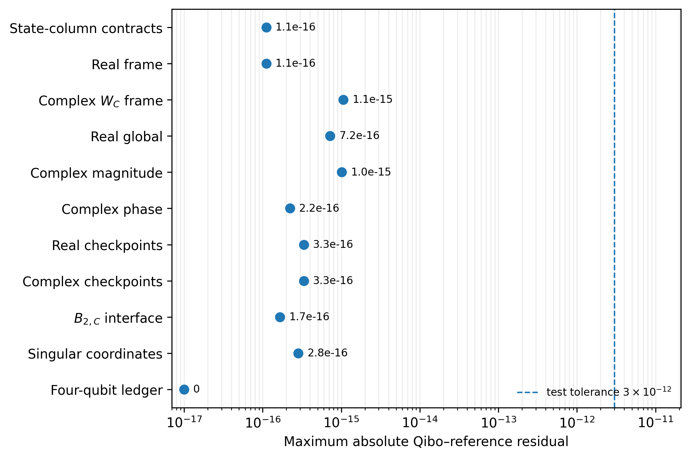
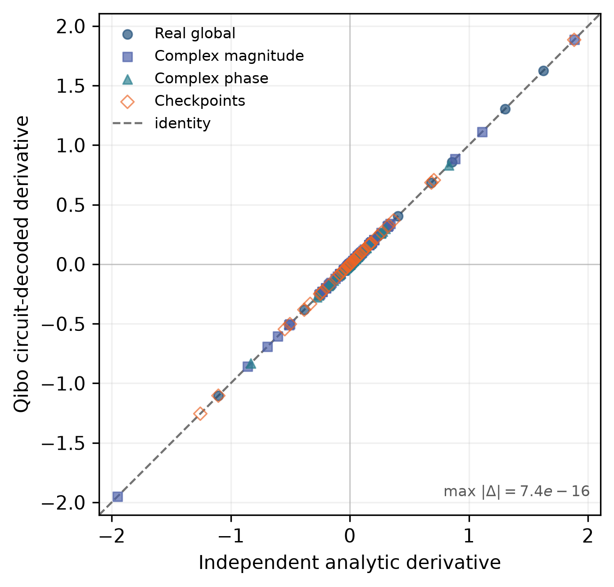

# Hopf Quantum Backpropagation

**How can one quantum measurement record contribute to the complete gradient of a variational state?** Hopf-QBP turns the Hopf ansatz's coordinate tangents into an addressed frame. Inverting that frame makes every global magnitude outcome informative about every magnitude coordinate; a separate leaf record supplies complex phase derivatives.

**Ruge Lin and Ranyiliu Chen — [Compass in the Mirror: Quantum Backpropagation with the Hopf Ansatz](https://arxiv.org/abs/2610.14177) (2026).**

The task is to return the complete classical vector of raw Hopf-coordinate derivatives with simultaneous absolute coordinate error at most $`\varepsilon`$ and confidence $`1-\delta`$. For $`n`$ qubits, $`N=2^n`$, and $`M=N-1`$ real or $`M=2N-1`$ complex coordinates:

| Result | Resource or guarantee |
|---|---|
| Global record | $`O((1+\log(n/\delta))/\varepsilon^2)`$ independent executions |
| Complete checkpoint schedule | $`O(n(1+\log(n/\delta))/\varepsilon^2)`$ independent executions |
| Direct-angle global Hopf work | $`O(M\log M)`$ assigned Hopf work per magnitude execution |
| Classical decoding | $`O(M\log M)`$ Walsh processing |
| Returned output | $`M`$ classical entries |

The controlled objective must be a known, phase-calibrated reflection. Each execution makes one controlled-reflection call; its implementation cost is accounted for separately from the assigned Hopf ledger. The fixed-accuracy $`O(\log\log M)`$ global execution count describes record reuse. The full gradient remains an exponentially large output in $`n`$. Exact multiplexed recompilation has its own circuit contract and resource account.

## Read the science

The [complete scientific account](science/README.md) contains the paper's main text and every appendix, with original equation, statement, protocol, figure, table, and reference identifiers. Follow the topic route below, or use the [reviewer crosswalk](review/README.md) to locate an item from the paper.

| To understand | Read |
|---|---|
| The question and relation to earlier work | [Motivation](science/motivation.md) |
| Objective access, output accuracy, and circuit contracts | [The reverse task](science/reverse-task.md) |
| Hopf differentials and forward interfaces | [Balanced differential](science/balanced-differential.md) |
| Addressed frames and shared magnitude records | [Global real method](science/global-real.md) |
| Phase-dressed magnitudes and direct phase records | [Global complex method](science/global-complex.md) |
| Layer-local reverse transport | [Checkpoint method](science/checkpoints.md) |
| Concentration, decoding, storage, and matched costs | [Accuracy and resources](science/accuracy-resources.md) |
| A complete concrete construction | [Four-qubit example](science/four-qubit-example.md) |
| Full analytical arguments and compiler derivations | [Proofs and compilation](science/proofs-and-compilation.md) |
| Implementation conventions and API | [Engineering guide](docs/ENGINEERING_GUIDE.md) |

The supporting guides explain [statistical output norms](docs/STATISTICAL_ACCURACY.md), [matched method comparisons](docs/METHOD_COMPARISON.md), [exact recompilation](docs/OPTIMIZED_COMPILATION.md), and [reflection sums and readout](docs/OBSERVABLES_AND_READOUT.md). The [bibliography](references/paper-bibliography.md) preserves the paper's attribution.

## Learn the project

The single educational anchor is **Michael A. Nielsen and Isaac L. Chuang, _Quantum Computation and Quantum Information_, 10th Anniversary Edition**. The [educational bridge](learning/ANCHOR.md) selects relevant sections, translates conventions, and develops the Hopf differential, interference, and statistical ideas needed for this work.

The [30-milestone map](learning/MILESTONES.md) contains **12 background/preliminaries milestones and 18 narrative/innovation milestones**. Both phases progress from local objects and mechanisms to the complete scientific story. Every milestone has an understanding target, dependencies, a conceptual connection, and source links.

## Verify and reproduce

Start with the [reviewer route](review/README.md): paper item → full statement and proof → implementation → executable check. The [reproduction guide](verification/README.md) gives environment setup, commands, figure reproduction, expected results, and tolerances.

Use Python 3.10–3.13. From the repository root:

```bash
python -m venv .venv
source .venv/bin/activate
python -m pip install -r requirements.txt -r requirements-optional.txt
python validate_qbp.py
```

Use `python validate_qbp.py --analytic` for Qibo-free checks or `--smoke` for representative circuit contracts. The deterministic suite compares circuits, output distributions, decoded gradients, and assigned ledgers against independent references. General concentration and complexity guarantees are established by their written proofs.

<p align="center">
  
</p>

<p align="center">
  
</p>

These supplementary implementation figures summarize finite-dimensional checks. The original paper figures appear with their captions in the scientific account.

## Companion paper

[Hopf-ansatz](https://github.com/GoGoKo699/Hopf-ansatz) develops the coordinates, inverse map, geometry, and indexed gradient access used here. Its paper is [A Compass on the Quantum State Sphere: The Hopf Ansatz for Arbitrary Pure-State Optimization](https://arxiv.org/abs/2607.14231). The repositories use the same educational anchor and reading structure and are independently runnable.

## Citation

**Ruge Lin and Ranyiliu Chen, “Compass in the Mirror: Quantum Backpropagation with the Hopf Ansatz,” arXiv:2610.14177 (2026).**

```bibtex
@misc{lin2026hopfqbp,
  title = {Compass in the Mirror: Quantum Backpropagation with the Hopf Ansatz},
  author = {Lin, Ruge and Chen, Ranyiliu},
  year = {2026},
  eprint = {2610.14177},
  archivePrefix = {arXiv},
  primaryClass = {quant-ph},
  url = {https://arxiv.org/abs/2610.14177}
}
```

Cite the companion [Hopf-ansatz paper](https://arxiv.org/abs/2607.14231) when using its state-preparation or geometric constructions. Machine-readable citation metadata is available in [CITATION.cff](CITATION.cff).

## Purpose and contact

This repository serves as a record of the work and a guide for the author’s self-directed learning. For discussion or potential collaboration, please contact Ruge Lin at [gogoko699@gmail.com](mailto:gogoko699@gmail.com).

## License

The software is released under the [MIT License](LICENSE). The scientific account identifies the authors and the arXiv source of the paper.
