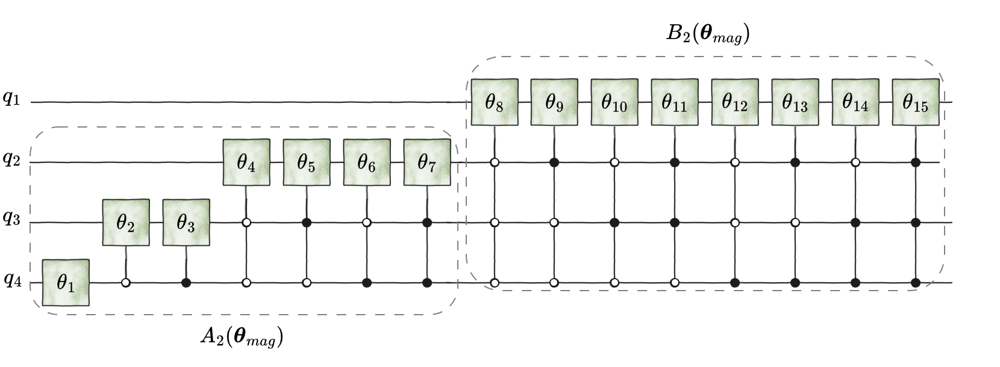
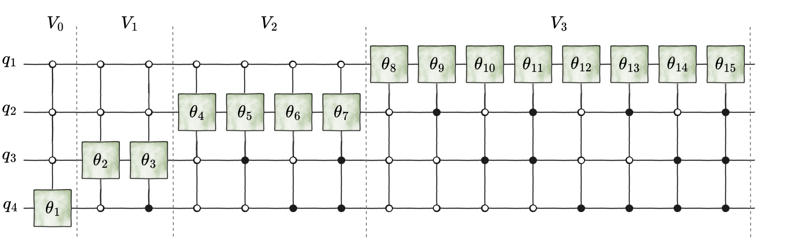
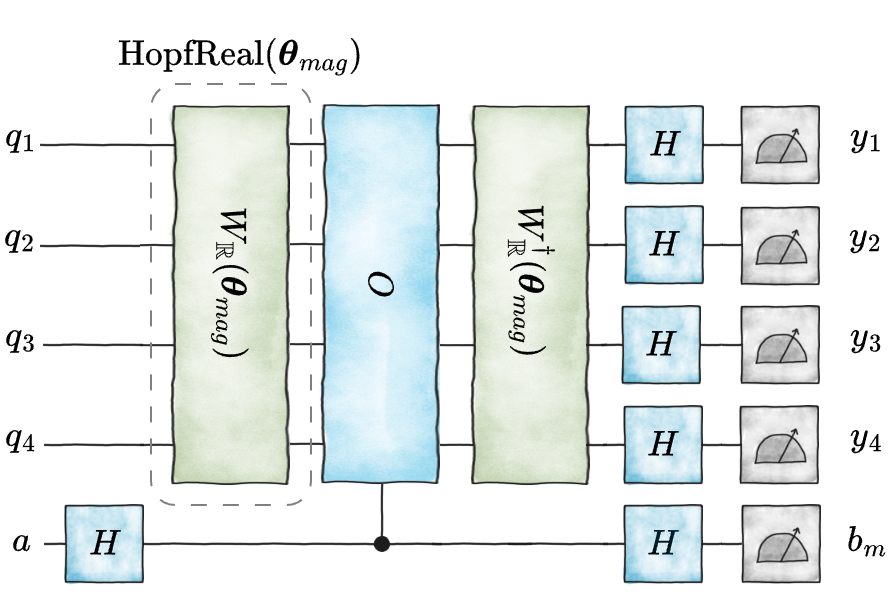
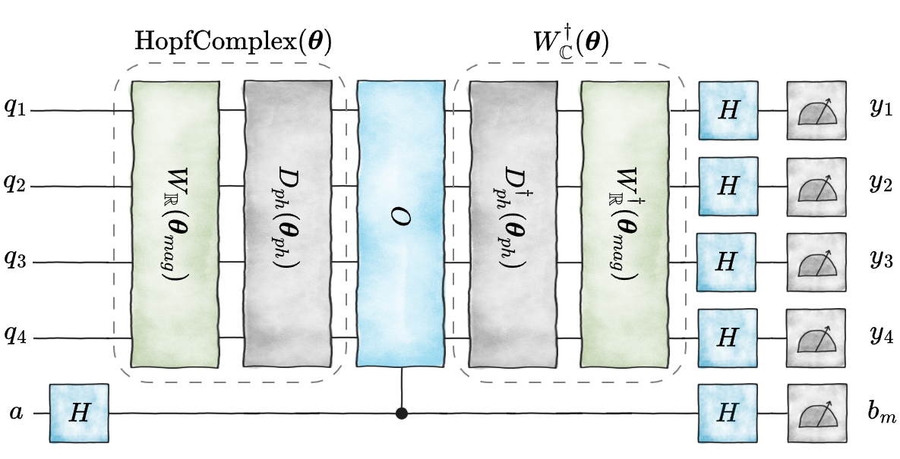
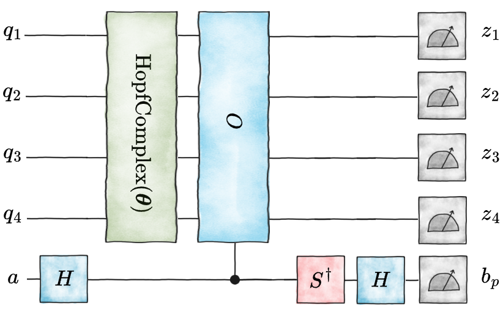
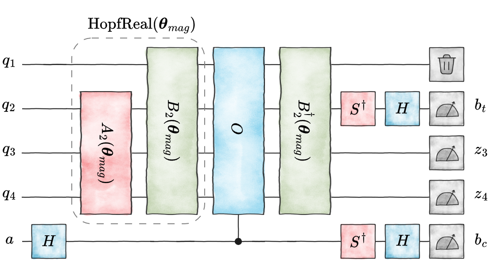
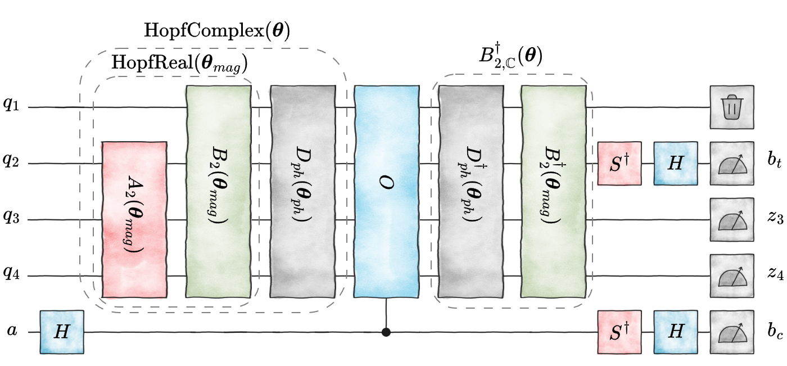

[Scientific text](README.md) · [Reviewer route](../review/README.md) · [Repository](../README.md)

<a id="A1"></a>

# Appendix A Four-qubit implementation companion

This appendix gives the $`n=4`$, $`N=16`$ instance. The figures display the native preparations, depth completion, addressed frames, global records, and depth-$`2`$ checkpoints. Three tables supplement the figures and general formulas.

<a id="A1.SS1"></a>

## A 1 How to read the four-qubit construction

The wires are drawn with $`q_{1}`$ at the top and $`q_{4}`$ at the bottom, while computational-basis labels use

<a id="A1.Ex84"></a>

```math
\lvert b_{\ell}\rangle =\lvert q_{4}q_{3}q_{2}q_{1}\rangle ,\qquad\ell=(q_{4}q_{3}q_{2}q_{1})_{2}.
```

A filled control fixes a basis bit to one, and an open control fixes it to zero. Rotations follow Eq. ([7](balanced-differential.md#S3.E7)); a library using $`\operatorname{RY}(\varphi)=e^{-\mathrm{i}\varphi Y/2}`$ therefore receives software angle $`2\theta`$. The dashed blocks use the full-unitary, state-column, and active-interface contracts of Eq. ([5](reverse-task.md#S2.E5)).

The coordinate blocks are

<a id="A1.EGx27"></a>

```math
\begin{aligned}\boldsymbol{\theta}_{\mathrm{mag}} & =(\theta_{1},\ldots,\theta_{15}), & \boldsymbol{\theta}_{\mathrm{ph}} & =(\theta_{16},\ldots,\theta_{31}),\end{aligned}
```

```math
\begin{aligned}\phi_{\ell} & :=\theta_{16+\ell}, & 0 & \leq\ell<16.\end{aligned}
```

<a id="A1.SS2"></a>

## A 2 Native real and complex preparation

<a id="A1.SS2.p1.1"></a>

The breadth-first internal indices are $`1,\ldots,15`$, and the leaves are $`16+\ell`$. In Fig. [A 2](four-qubit-example.md#A1.SS2), the uncircled labels give the internal-node indices and the circled labels give the native gate order of Ref. [[1](../references/paper-bibliography.md#bib.bib6)].

<a id="A1.SS2.fig1"></a>


Figure 1: Four-qubit Hopf tree in the first-paper convention. A left branch contributes $`\cos\theta_{j}`$ and a right branch contributes $`\sin\theta_{j}`$. The internal labels are the magnitude coordinates, the blue labels beneath the leaves are the complex phase coordinates, and the circled numbers give the native gate-application order. Padded binary labels identify subtree anchors and leaves.

The promoted two-leaf completion used by the complex circuit is

<a id="A1.Ex87"></a>

```math
R_{\mathbb{C}}(\theta_{a},\theta_{b},\theta_{c})=\begin{pmatrix}e^{\mathrm{i}\theta_{b}}\cos\theta_{a}&-e^{-\mathrm{i}\theta_{c}}\sin\theta_{a}\\
e^{\mathrm{i}\theta_{c}}\sin\theta_{a}&\phantom{-}e^{-\mathrm{i}\theta_{b}}\cos\theta_{a}\end{pmatrix}.
```

<a id="A1.SS2.p2.2"></a>

Its first column assigns phases $`\theta_{b}`$ and $`\theta_{c}`$ to two sibling leaves. The native circuit follows the circled tree order; its complete control schedule is inherited from Ref. [[1](../references/paper-bibliography.md#bib.bib6)] and implemented in the accompanying validation code.

<a id="A1.SS2.fig2"></a>


Figure 2: Native four-qubit Hopf ansatz circuit. For $`\mathrm{HopfReal}(\boldsymbol{\theta}_{\mathrm{mag}})`$, every box is $`R_{y}(\theta_{j})`$. For $`\mathrm{HopfComplex}(\boldsymbol{\theta})`$, each final-layer gate $`j=8+r`$, $`0\leq r<8`$, is promoted to $`R_{\mathbb{C}}(\theta_{8+r},\theta_{16+2r},\theta_{17+2r})`$. The blue boxes identify that promoted final layer.

The initialized native columns prepare $`\lvert \psi^{\mathbb{R}}\rangle`$ and $`\lvert \psi^{\mathbb{C}}\rangle`$; the complete state-column contracts are collected below with the depth and frame completions.

<a id="A1.SS3"></a>

## A 3 Metric factors and tangent-state registry

The single registry below combines the incoming metric factor, the real-frame anchor and marker, and the checkpoint prefix and target for every internal node.

<a id="A1.SS3.fig1"></a>

| $`j`$ | $`(d,r)`$ | $`\sqrt{g^{\mathbb{R}}_{j,j}}`$ | $`\ell_{0}(j)`$ | $`\lambda(j)`$ |
| --- | --- | --- | --- | --- |
| 1 | $`(0,0)`$ | $`1`$ | 0 | 8 |
| 2 | $`(1,0)`$ | $`\cos\theta_{1}`$ | 0 | 4 |
| 3 | $`(1,1)`$ | $`\sin\theta_{1}`$ | 8 | 12 |
| 4 | $`(2,0)`$ | $`\cos\theta_{1}\cos\theta_{2}`$ | 0 | 2 |
| 5 | $`(2,1)`$ | $`\cos\theta_{1}\sin\theta_{2}`$ | 4 | 6 |
| 6 | $`(2,2)`$ | $`\sin\theta_{1}\cos\theta_{3}`$ | 8 | 10 |
| 7 | $`(2,3)`$ | $`\sin\theta_{1}\sin\theta_{3}`$ | 12 | 14 |
| 8 | $`(3,0)`$ | $`\cos\theta_{1}\cos\theta_{2}\cos\theta_{4}`$ | 0 | 1 |
| 9 | $`(3,1)`$ | $`\cos\theta_{1}\cos\theta_{2}\sin\theta_{4}`$ | 2 | 3 |
| 10 | $`(3,2)`$ | $`\cos\theta_{1}\sin\theta_{2}\cos\theta_{5}`$ | 4 | 5 |
| 11 | $`(3,3)`$ | $`\cos\theta_{1}\sin\theta_{2}\sin\theta_{5}`$ | 6 | 7 |
| 12 | $`(3,4)`$ | $`\sin\theta_{1}\cos\theta_{3}\cos\theta_{6}`$ | 8 | 9 |
| 13 | $`(3,5)`$ | $`\sin\theta_{1}\cos\theta_{3}\sin\theta_{6}`$ | 10 | 11 |
| 14 | $`(3,6)`$ | $`\sin\theta_{1}\sin\theta_{3}\cos\theta_{7}`$ | 12 | 13 |
| 15 | $`(3,7)`$ | $`\sin\theta_{1}\sin\theta_{3}\sin\theta_{7}`$ | 14 | 15 |

Table I: Four-qubit internal-node registry. For $`j=2^{d}+r`$, the checkpoint prefix is $`r`$, its target is $`q_{4-d}`$, $`\ell_{0}(j)`$ is the left-child anchor, and $`\lambda(j)`$ addresses the normalized local complement.

The same incoming factors govern the complex magnitude block by Eq. ([31](global-complex.md#S5.E31)). For the nontrivial node $`5`$, the normalized local complement is

<a id="A1.Ex88"></a>

```math
\lvert e_{5}^{\mathbb{R}}\rangle =-\sin\theta_{5}\left(\cos\theta_{10}\lvert 0100\rangle +\sin\theta_{10}\lvert 0101\rangle \right)+\cos\theta_{5}\left(\cos\theta_{11}\lvert 0110\rangle +\sin\theta_{11}\lvert 0111\rangle \right),
```

and the corresponding incoming factor is

<a id="A1.E59"></a>

```math
\sqrt{g^{\mathbb{R}}_{5,5}}=\cos\theta_{1}\sin\theta_{2}.\tag{A1}
```

<a id="A1.SS4"></a>

## A 4 Depth completion $`U_{\mathrm{chk}}`$

The four depth layers are

<a id="A1.EGx28"></a>

```math
\begin{aligned}U_{0} & =R_{y}^{(q_{4})}(\theta_{1}),\end{aligned}
```

```math
\begin{aligned}U_{1} & =\sum_{r=0}^{1}\lvert r\rangle \!\langle r\rvert _{q_{4}}\otimes R_{y}^{(q_{3})}(\theta_{2+r}),\end{aligned}
```

```math
\begin{aligned}U_{2} & =\sum_{r=0}^{3}\lvert r\rangle \!\langle r\rvert _{q_{4}q_{3}}\otimes R_{y}^{(q_{2})}(\theta_{4+r}),\end{aligned}
```

```math
\begin{aligned}U_{3} & =\sum_{r=0}^{7}\lvert r\rangle \!\langle r\rvert _{q_{4}q_{3}q_{2}}\otimes R_{y}^{(q_{1})}(\theta_{8+r}).\end{aligned}
```

Thus

<a id="A1.Ex93"></a>

```math
U_{\mathrm{chk}}=U_{3}U_{2}U_{1}U_{0},\qquad A_{2}:=U_{2}U_{1}U_{0},\qquad B_{2}:=U_{3},\qquad U_{\mathrm{chk}}=B_{2}A_{2}.
```

<a id="A1.SS4.fig1"></a>



Figure 3: Four-qubit depth completion. The left bracket is $`A_{2}(\boldsymbol{\theta}_{\mathrm{mag}})=U_{2}U_{1}U_{0}`$ and the right bracket is $`B_{2}(\boldsymbol{\theta}_{\mathrm{mag}})=U_{3}`$, giving the full-unitary factorization $`U_{\mathrm{chk}}=B_{2}A_{2}`$. Open controls select zero-valued prefix bits. Section [A 8](four-qubit-example.md#A1.SS8) constructs the corresponding complex depth-$`2`$ completion.

The native and depth completions share the initialized real state column in Eq. ([A2](four-qubit-example.md#A1.E60)), although their actions on the remaining columns generally differ.

<a id="A1.SS5"></a>

## A 5 Real addressed frame $`W_{\mathbb{R}}`$

For $`j=2^{d}+r`$, Table [I](four-qubit-example.md#A1.SS3.fig1) gives the active pair $`\lvert b_{\ell_{0}(j)}\rangle \leftrightarrow\lvert b_{\lambda(j)}\rangle`$. The target is $`q_{4-d}`$, and the controls fix the remaining bits to the anchor pattern. Applying parent layers before descendants gives

<a id="A1.Ex94"></a>

```math
W_{\mathbb{R}}(\boldsymbol{\theta}_{\mathrm{mag}})=V_{3}V_{2}V_{1}V_{0},
```

with $`V_{0}`$ applied first in state-update order.

<a id="A1.SS5.fig1"></a>



Figure 4: Fully addressed four-qubit real-magnitude frame $`W_{\mathbb{R}}`$, with $`V_{0}`$ acting first. Every non-target qubit is fixed by a closed or open control, so each gate preserves the required state-and-complement column action. A box labeled $`\theta_{j}`$ denotes Eq. ([7](balanced-differential.md#S3.E7)). The same addressed gate skeleton is used for the complex-magnitude frame constructed in Sec. [A 6](four-qubit-example.md#A1.SS6). Circuit layouts use the visual language of the quantum-circuit-drawio library [[44](../references/paper-bibliography.md#bib.bib16)].

For node $`5`$, the addressed gate first gives

<a id="A1.Ex95"></a>

```math
G_{5}\lvert 0110\rangle =-\sin\theta_{5}\lvert 0100\rangle +\cos\theta_{5}\lvert 0110\rangle .
```

The descendant gates then map $`\lvert 0110\rangle`$ to the previously displayed $`\lvert e_{5}^{\mathbb{R}}\rangle`$. Together with Eq. ([A1](four-qubit-example.md#A1.E59)), this gives $`\partial_{\theta_{5}}\lvert \psi^{\mathbb{R}}\rangle =\cos\theta_{1}\sin\theta_{2}\lvert e_{5}^{\mathbb{R}}\rangle`$. The complete frame obeys

<a id="A1.Ex96"></a>

```math
W_{\mathbb{R}}\lvert 0000\rangle =\lvert \psi^{\mathbb{R}}\rangle ,\qquad W_{\mathbb{R}}\lvert b_{\lambda(j)}\rangle =\lvert e_{j}^{\mathbb{R}}\rangle ,\quad 1\leq j\leq 15.
```

Thus

<a id="A1.E60"></a>

```math
\mathrm{HopfReal}\lvert 0000\rangle =U_{\mathrm{chk}}\lvert 0000\rangle =W_{\mathbb{R}}\lvert 0000\rangle =\lvert \psi^{\mathbb{R}}\rangle ,\tag{A2}
```

while the three circuits generally give different full-unitary completions.

<a id="A1.SS6"></a>

## A 6 Complex magnitude frame $`W_{\mathbb{C}}`$

Define

<a id="A1.EGx29"></a>

```math
\begin{aligned}D_{\mathrm{ph}}(\boldsymbol{\theta}_{\mathrm{ph}}) & :=\sum_{\ell=0}^{15}e^{\mathrm{i}\phi_{\ell}}\lvert b_{\ell}\rangle \!\langle b_{\ell}\rvert ,\end{aligned}
```

```math
\begin{aligned}W_{\mathbb{C}}(\boldsymbol{\theta}) & :=D_{\mathrm{ph}}(\boldsymbol{\theta}_{\mathrm{ph}})W_{\mathbb{R}}(\boldsymbol{\theta}_{\mathrm{mag}}).\end{aligned}
```

Then

<a id="A1.EGx30"></a>

```math
\begin{aligned}\mathrm{HopfComplex}(\boldsymbol{\theta})\lvert 0000\rangle & =D_{\mathrm{ph}}U_{\mathrm{chk}}\lvert 0000\rangle =W_{\mathbb{C}}(\boldsymbol{\theta})\lvert 0000\rangle =\lvert \psi^{\mathbb{C}}\rangle ,\end{aligned}
```

```math
\begin{aligned}W_{\mathbb{C}}\lvert b_{\lambda(j)}\rangle & =\lvert e_{j}^{\mathbb{C}}\rangle ,\qquad 1\leq j\leq 15,\end{aligned}
```

<a id="A1.E61"></a>

```math
\begin{aligned}W_{\mathbb{C}}^{\dagger} & =W_{\mathbb{R}}^{\dagger}D_{\mathrm{ph}}^{\dagger}.\end{aligned}\tag{A3}
```

The first line is a state-column contract for the native and depth forwards; the remaining two identities fix the complete complex-magnitude frame used by the global record.

<a id="A1.SS6.SSS1"></a>

### A 6 a Addressed $`R_{\mathbb{C}}`$ compilation up to a compiler global phase

Let

<a id="A1.Ex101"></a>

```math
\bar{\phi}:=\frac{1}{16}\sum_{\ell=0}^{15}\phi_{\ell},\qquad\widehat{\phi}_{\ell}:=\phi_{\ell}-\bar{\phi},
```

and define centered subtree sums by

<a id="A1.Ex102"></a>

```math
\Phi_{16+\ell}:=\widehat{\phi}_{\ell},\qquad\Phi_{j}:=\Phi_{2j}+\Phi_{2j+1}.
```

On the same active pair and with the same controls as the real gate, use

<a id="A1.E62"></a>

```math
\widetilde{G}_{j}:=R_{\mathbb{C}}\!\left(\theta_{j},-\Phi_{2j+1},-\Phi_{2j}\right).\tag{A4}
```

With the same parent-before-descendant order,

<a id="A1.E63"></a>

```math
\boxed{\widetilde{W}_{\mathbb{C}}^{(R_{\mathbb{C}})}=e^{-\mathrm{i}\bar{\phi}}W_{\mathbb{C}}.}\tag{A5}
```

The compiler global phase multiplies every column equally and therefore leaves the protocol probabilities unchanged.

The recursion determines every gate directly. For example, the second and third arguments of $`\widetilde{G}_{1}`$ are

<a id="A1.Ex103"></a>

```math
\left(-\sum_{\ell=8}^{15}\widehat{\phi}_{\ell},-\sum_{\ell=0}^{7}\widehat{\phi}_{\ell}\right),
```

while those of $`\widetilde{G}_{5}`$ are

<a id="A1.Ex104"></a>

```math
\left(-\widehat{\phi}_{6}-\widehat{\phi}_{7},-\widehat{\phi}_{4}-\widehat{\phi}_{5}\right).
```

All remaining arguments follow from the same two subtree sums.

<a id="A1.SS7"></a>

## A 7 Global gradient records

The real circuit uses native preparation for the initialized state column and $`W_{\mathbb{R}}^{\dagger}`$ for the complete reverse frame.

<a id="A1.SS7.fig1"></a>



Figure 5: Real-Hopf global-gradient circuit. The forward bracket uses the state-column contract $`\mathrm{HopfReal}(\boldsymbol{\theta}_{\mathrm{mag}})\lvert 0000\rangle =W_{\mathbb{R}}(\boldsymbol{\theta}_{\mathrm{mag}})\lvert 0000\rangle`$. The reverse block is $`W_{\mathbb{R}}^{\dagger}`$. The measured bits are $`b_{m}`$ and $`\boldsymbol{y}=(y_{1},y_{2},y_{3},y_{4})`$.

Repeating this sole real-global template $`S_{\mathrm{mag}}^{\mathbb{R}}`$ times produces $`S_{\mathrm{mag}}^{\mathbb{R}}`$ joint five-bit outcomes, each reused for all fifteen markers. For node $`5`$, $`\lambda(5)=0110`$ and $`\sqrt{g^{\mathbb{R}}_{5,5}}=\cos\theta_{1}\sin\theta_{2}`$, so the main-text parity record becomes

<a id="A1.Ex105"></a>

```math
Z_{5}^{\mathbb{R}}=2\cos\theta_{1}\sin\theta_{2}(-1)^{b_{m}+y_{3}+y_{2}}.
```

The other fourteen components are read from the same outcome using their markers in Table [I](four-qubit-example.md#A1.SS3.fig1).

For complex magnitudes, the initialized-state chain is the first line of Eq. ([A3](four-qubit-example.md#A1.E61)). The same Walsh parity then decodes the phase-dressed magnitude frame.

<a id="A1.SS7.fig2"></a>



Figure 6: Complex-Hopf magnitude circuit. The forward bracket uses the state-column chain in Eq. ([A3](four-qubit-example.md#A1.E61)). The reverse bracket uses the full-unitary identity $`W_{\mathbb{C}}^{\dagger}=W_{\mathbb{R}}^{\dagger}D_{\mathrm{ph}}^{\dagger}`$, so the physical order is $`D_{\mathrm{ph}}^{\dagger}`$ followed by $`W_{\mathbb{R}}^{\dagger}`$. The addressed $`R_{\mathbb{C}}`$ compiler realizes the same decoder up to the compiler global phase in Eq. ([A5](four-qubit-example.md#A1.E63)).

Repeating this magnitude template $`S_{\mathrm{mag}}^{\mathbb{C}}`$ times gives $`S_{\mathrm{mag}}^{\mathbb{C}}`$ joint five-bit all-$`X`$ outcomes, and every outcome is reused across all fifteen complex-magnitude markers.

The leaf phases use the direct ancilla-$`Y`$/system-$`Z`$ record of Eq. ([36](global-complex.md#S5.E36)).

<a id="A1.SS7.fig3"></a>



Figure 7: Direct complex phase circuit. Native $`\mathrm{HopfComplex}(\boldsymbol{\theta})`$ prepares the state through the state-column contract in Eq. ([A3](four-qubit-example.md#A1.E61)). After the controlled reflection, the system is measured in $`Z`$ and the branch ancilla in $`Y`$, implemented by $`S^{\dagger}`$ followed by $`H`$. This circuit uses the leaf-local phase record directly.

Repeating the phase template $`S_{\mathrm{ph}}^{\mathbb{C}}`$ times gives a signed histogram over the sixteen leaves; each five-bit outcome updates exactly one phase bin. Thus the three figures implement, respectively, all fifteen real magnitudes, all fifteen complex magnitudes, and all sixteen complex leaf phases without introducing any four-qubit-specific decoder formula.

<a id="A1.SS8"></a>

## A 8 Checkpoint records and complex suffix $`B_{2,\mathbb{C}}`$

The four real checkpoint settings are:

<a id="A1.SS8.fig1"></a>

| $`d`$ | Prefix in $`Z`$ | Target in $`Y`$ | Inverse suffix | Discard |
| --- | --- | --- | --- | --- |
| $`0`$ | none | $`q_{4}`$ | $`U_{1}^{\dagger}U_{2}^{\dagger}U_{3}^{\dagger}`$ | $`q_{3}q_{2}q_{1}`$ |
| $`1`$ | $`q_{4}`$ | $`q_{3}`$ | $`U_{2}^{\dagger}U_{3}^{\dagger}`$ | $`q_{2}q_{1}`$ |
| $`2`$ | $`q_{4}q_{3}`$ | $`q_{2}`$ | $`U_{3}^{\dagger}`$ | $`q_{1}`$ |
| $`3`$ | $`q_{4}q_{3}q_{2}`$ | $`q_{1}`$ | $`I`$ | none |

Table II: All four real checkpoint settings. Compiler charges are consolidated in Table [III](four-qubit-example.md#A1.SS9.fig1).

At depth $`2`$, the measured prefix and coordinate index are

<a id="A1.Ex106"></a>

```math
\widehat{r}=(z_{4}z_{3})_{2},\qquad j=4+\widehat{r}.
```

The target $`q_{2}`$ and branch ancilla are measured in $`Y`$, the prefix $`q_{4}q_{3}`$ in $`Z`$, and $`q_{1}`$ is discarded.

<a id="A1.SS8.fig2"></a>



Figure 8: Real-Hopf depth-$`2`$ checkpoint. The forward bracket uses the state-column contract $`\mathrm{HopfReal}(\boldsymbol{\theta}_{\mathrm{mag}})\lvert 0000\rangle =B_{2}A_{2}\lvert 0000\rangle`$. After controlled-$`O`$, the reverse suffix is $`B_{2}^{\dagger}=U_{3}^{\dagger}`$. One execution returns $`-2(-1)^{b_{c}+b_{t}}\mathbf{e}_{\widehat{r}}`$ for nodes $`4,5,6,7`$.

For node $`5`$, corresponding to $`r=1`$,

<a id="A1.Ex107"></a>

```math
Q_{2,1}=\lvert 01\rangle \!\langle 01\rvert _{q_{4}q_{3}}\otimes Y_{q_{2}}\otimes I_{q_{1}},
```

and with $`\lvert \alpha_{2}\rangle :=A_{2}\lvert 0000\rangle`$ and $`\lvert \beta_{2}^{\mathbb{R}}\rangle :=B_{2}^{\dagger}O\lvert \psi^{\mathbb{R}}\rangle`$,

<a id="A1.Ex108"></a>

```math
\partial_{\theta_{5}}E_{O}=2\operatorname{Im}\langle \beta_{2}^{\mathbb{R}}\rvert Q_{2,1}\lvert \alpha_{2}\rangle .
```

<a id="A1.SS8.SSS1"></a>

### A 8 a Complex depth-$`2`$ active-interface construction

The reached-interface projector is

<a id="A1.Ex109"></a>

```math
P_{2}:=I_{q_{4}q_{3}q_{2}}\otimes\lvert 0\rangle \!\langle 0\rvert _{q_{1}}.
```

Define the eight-sector completion compactly by

<a id="A1.Ex110"></a>

```math
\boxed{B_{2,\mathbb{C}}(\boldsymbol{\theta}):=\sum_{p=0}^{7}\lvert p\rangle \!\langle p\rvert _{q_{4}q_{3}q_{2}}\otimes R_{\mathbb{C}}^{(q_{1})}\!\left(\theta_{8+p},\phi_{2p},\phi_{2p+1}\right).}
```

Its first column in each prefix sector satisfies

<a id="A1.Ex111"></a>

```math
B_{2,\mathbb{C}}\lvert p,0\rangle =e^{\mathrm{i}\phi_{2p}}\cos\theta_{8+p}\lvert p,0\rangle +e^{\mathrm{i}\phi_{2p+1}}\sin\theta_{8+p}\lvert p,1\rangle =D_{\mathrm{ph}}B_{2}\lvert p,0\rangle ,
```

so

<a id="A1.E64"></a>

```math
\boxed{B_{2,\mathbb{C}}P_{2}=D_{\mathrm{ph}}B_{2}P_{2}.}\tag{A6}
```

The unused second column of each $`R_{\mathbb{C}}`$ gate completes the unitary outside the reached interface. With $`\lvert \beta_{2}^{\mathbb{C}}\rangle :=B_{2,\mathbb{C}}^{\dagger}O\lvert \psi^{\mathbb{C}}\rangle`$, the four transported derivatives are

<a id="A1.E65"></a>

```math
\partial_{\theta_{4+r}}E_{O}=2\operatorname{Im}\langle \beta_{2}^{\mathbb{C}}\rvert Q_{2,r}\lvert \alpha_{2}\rangle ,\qquad r=0,1,2,3.\tag{A7}
```

<a id="A1.SS8.SSS1.fig1"></a>



Figure 9: Complex-Hopf magnitude checkpoint at depth $`2`$. The inner and outer forward brackets use the real and complex state-column contracts. The reverse bracket uses the active-interface identity $`B_{2,\mathbb{C}}P_{2}=D_{\mathrm{ph}}B_{2}P_{2}`$, which gives the same checkpoint correlators as the separated physical sequence $`D_{\mathrm{ph}}^{\dagger}`$ followed by $`B_{2}^{\dagger}`$. The readout measures $`q_{4}q_{3}`$ in $`Z`$ and $`q_{2}`$ together with the ancilla in $`Y`$, while $`q_{1}`$ is discarded because it belongs to the unused lower suffix.

In either depth-$`2`$ circuit, one execution gives

<a id="A1.Ex112"></a>

```math
Z_{2}^{\mathrm{chk}}=-2(-1)^{b_{c}+b_{t}}\mathbf{e}_{\widehat{r}},\qquad\mathbb{E}Z_{2}^{\mathrm{chk}}=\left(\partial_{\theta_{4}}E_{O},\partial_{\theta_{5}}E_{O},\partial_{\theta_{6}}E_{O},\partial_{\theta_{7}}E_{O}\right)^{\mathsf{T}},\qquad\|Z_{2}^{\mathrm{chk}}\|_{2}=2.
```

Repeating the selected depth-$`2`$ template and averaging this one-hot record recovers all four displayed derivatives. Recovering another depth requires its own suffix and measurement target from Table [II](four-qubit-example.md#A1.SS8.fig1).

<a id="A1.SS9"></a>

## A 9 Four-qubit assigned Hopf CNOT ledger

Under the adopted direct-angle ledger inherited from the first paper, a three-controlled $`R_{y}`$ or $`R_{\mathbb{C}}`$ gate costs $`14`$ CNOTs. The native schedule contains one uncontrolled, four one-controlled, six two-controlled, and four three-controlled gates, giving charge $`100`$. The depth layers cost $`0,4,24,112`$, so $`C_{\mathrm{H}}(U_{\mathrm{chk}})=140`$ and $`C_{\mathrm{H}}(B_{2})=112`$. The addressed frames use fifteen three-controlled gates, whereas $`B_{2,\mathbb{C}}`$ uses the eight sectors of the selected depth-$`2`$ suffix.

<a id="A1.SS9.fig1"></a>

| Item | Charge | Role, contract, or implemented blocks |
| --- | --- | --- |
| $`\mathrm{HopfReal}`$ | $`100`$ | Native real state preparation. |
| $`\mathrm{HopfComplex}`$ | $`100`$ | Native complex state preparation with eight final-layer $`R_{\mathbb{C}}`$ gates. |
| $`U_{\mathrm{chk}}`$ | $`140`$ | Depth completion and designated separated scalar/checkpoint forward program. |
| $`B_{2}`$ | $`112`$ | Real inverse suffix at depth $`2`$. |
| $`W_{\mathbb{R}}`$ | $`210`$ | Complete real state-and-tangent frame. |
| $`W_{\mathbb{C}}`$ | $`210`$ | Complete complex magnitude frame, compiled up to one compiler global phase. |
| $`B_{2,\mathbb{C}}`$ | $`112`$ | Complex suffix satisfying $`B_{2,\mathbb{C}}P_{2}=D_{\mathrm{ph}}B_{2}P_{2}`$. |
| Real global record | $`310`$ | $`\mathrm{HopfReal}`$ followed by $`W_{\mathbb{R}}^{\dagger}`$. |
| Complex magnitude record | $`310`$ | $`\mathrm{HopfComplex}`$ followed by $`W_{\mathbb{C}}^{\dagger}`$. |
| Direct complex phase record | $`100`$ | $`\mathrm{HopfComplex}`$ with no reverse frame. |
| Real depth-$`2`$ checkpoint | $`212`$ | $`\mathrm{HopfReal}`$ followed by $`B_{2}^{\dagger}`$. |
| Complex depth-$`2`$ checkpoint | $`212`$ | $`\mathrm{HopfComplex}`$ followed by $`B_{2,\mathbb{C}}^{\dagger}`$. |

Table III: Four-qubit compiler and record charges under the same direct-angle $`C_{\mathrm{H}}`$ functional used in the theorem; the controlled observable and readout are excluded by definition. The theorem uses the designated separated schedules, while this table evaluates native-forward and integrated reverse alternatives whose finite constant ratios need not be $`2`$ and $`1`$.

The $`310`$ global charge contributes to all fifteen magnitude coordinates; the $`212`$ checkpoint charge contributes to the four active depth-$`2`$ coordinates. Native-forward records from all four real checkpoint families cost $`240+236+212+100=788`$ in the same Hopf-only ledger. The finite comparison displays the same global-versus-local protocol choice: checkpointing is cheaper for an active layer, while the complete frame reuses one preparation, oracle call, and outcome across every depth. These native and integrated finite ratios are illustrative; the theorem instead uses the constants of the designated separated schedules.
